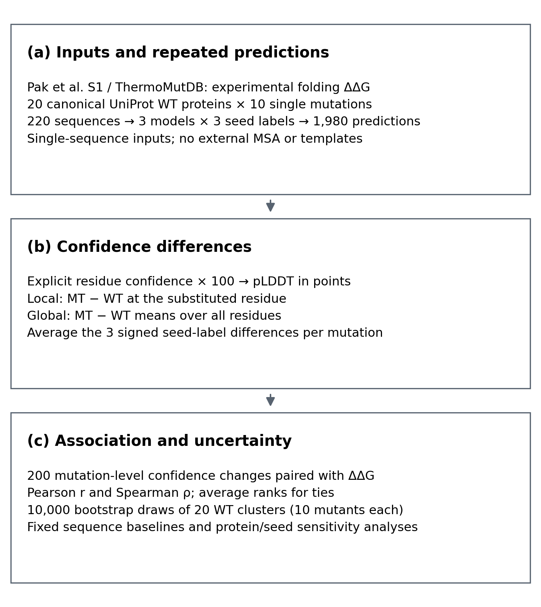
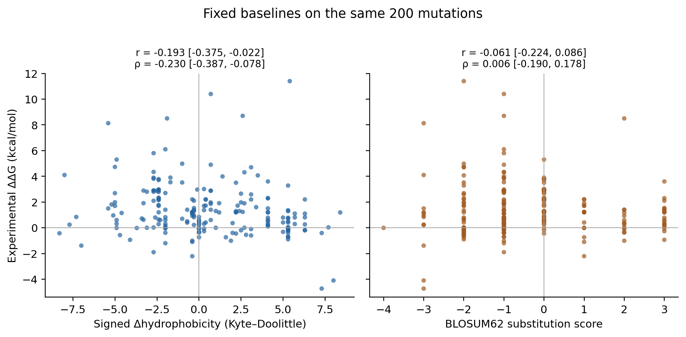
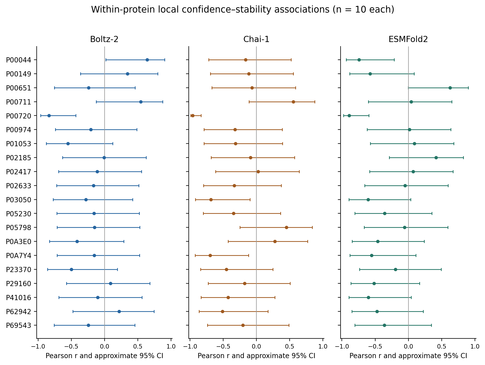
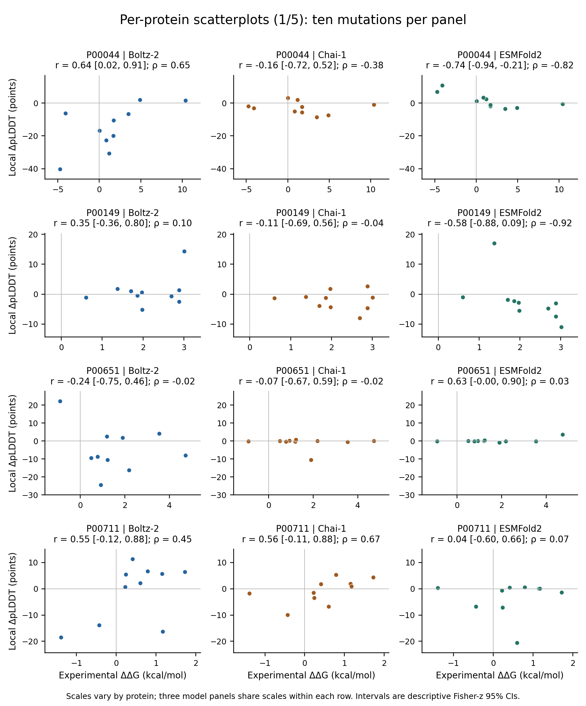
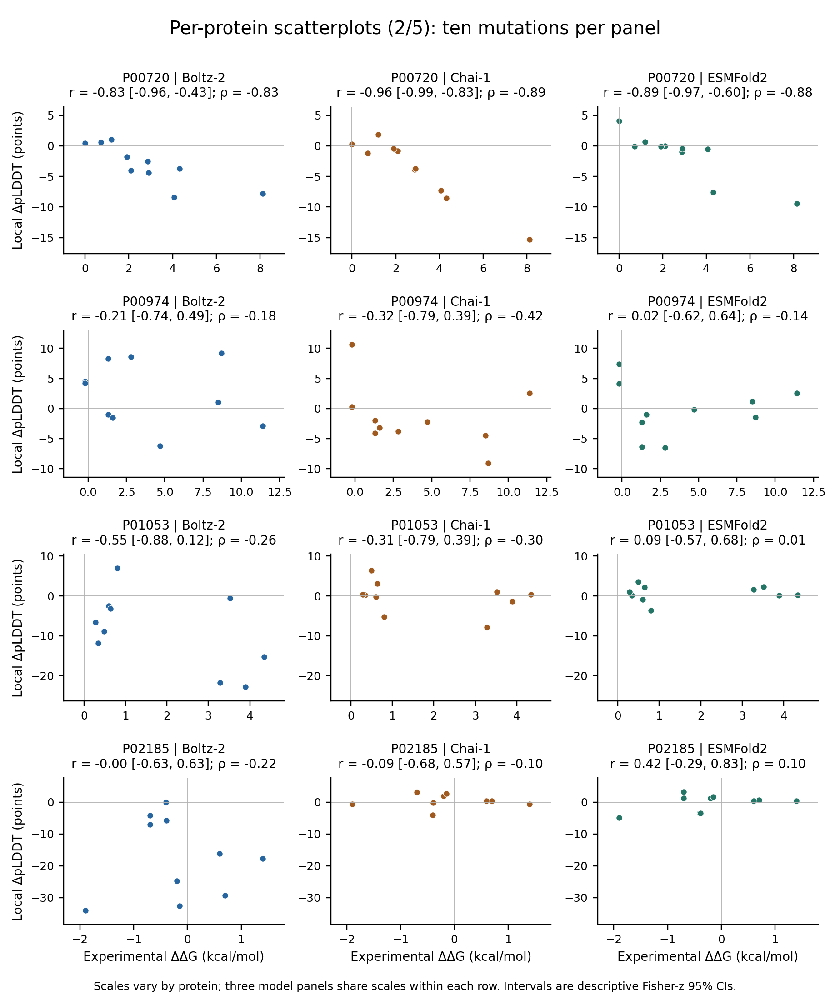
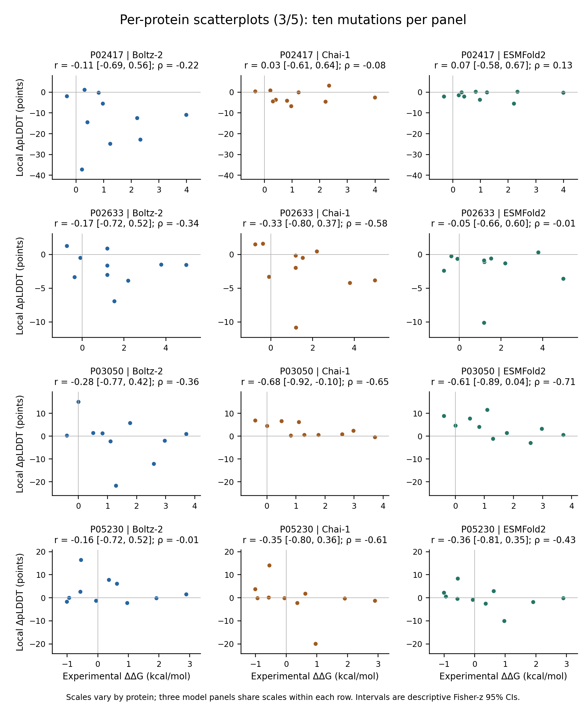
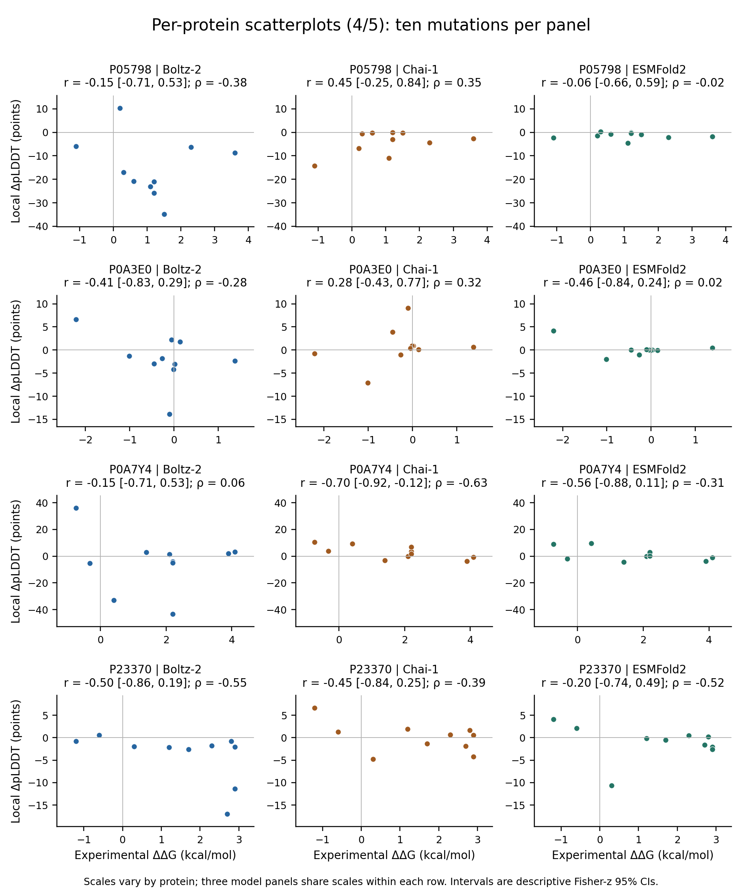
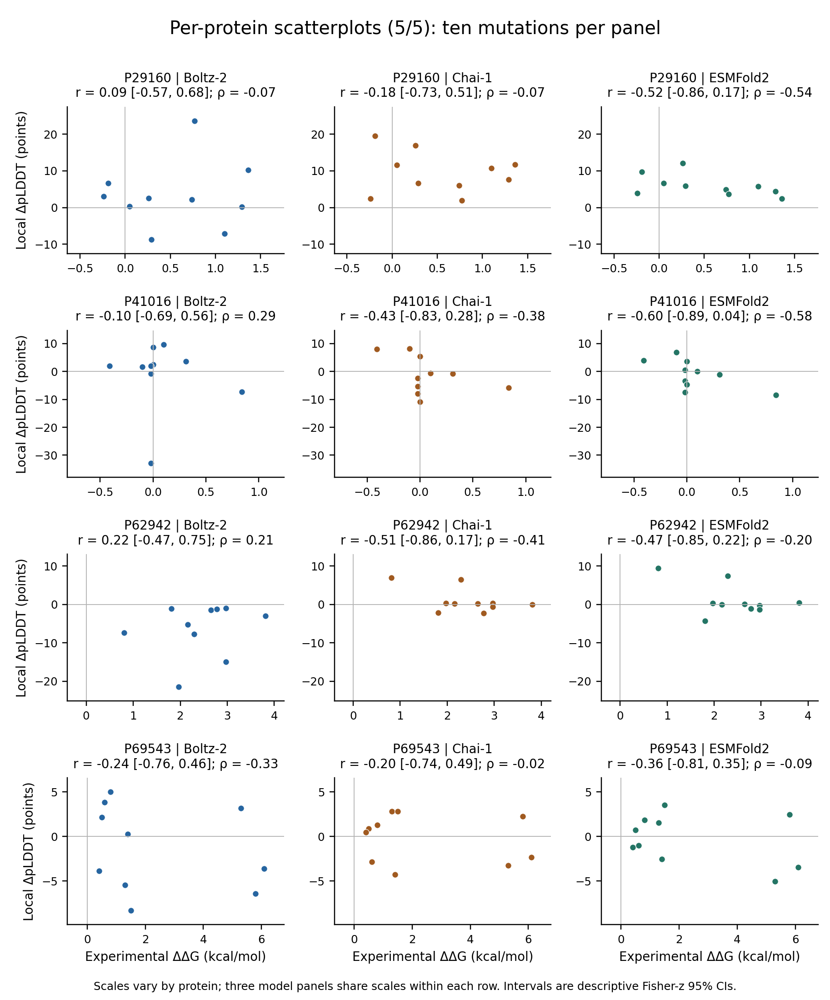

# Supplementary Appendix for CSAI 2026 Paper 129

Associated manuscript: **Investigating the Relationship Between AI-Based Structure Prediction Confidence and Experimentally Determined Protein Stability**.

The scientific content below reproduces the self-contained supplementary appendix dated 7 November 2026. Table and figure identifiers, numerical values and limitations are unchanged.

[Download PDF directly](https://raw.githubusercontent.com/nickzhang20040104-dev/csai129-protein-stability-supplement/main/supplement/CSAI129_Supplementary_Information.pdf) · [Back to repository overview](README.md)

## Appendix index

| Section | Contents |
| --- | --- |
| [scope](#scope) | Scope and data definitions |
| [analysis](#analysis) | Analysis added during revision |
| [figure-s1](#figure-s1) | Figure S1 Workflow |
| [table-s1](#table-s1) | Table S1 Canonical WT protein inventory |
| [table-s2](#table-s2) | Table S2 Local and global correlation summaries |
| [table-s3](#table-s3) | Table S3 Local confidence changes by stability direction |
| [table-s4](#table-s4) | Table S4 Fixed baseline correlations |
| [table-s5](#table-s5) | Table S5 Complete experimental mutation records |
| [software](#software) | Software and inference provenance |
| [s6](#s6) | S6 Recorded execution costs and environment |
| [s7](#s7) | S7 Paired baseline comparisons |
| [s8](#s8) | S8 Per-protein heterogeneity |
| [s9](#s9) | S9 Data integrity and analysis provenance |
| [references](#references) | References |

Paper BJ-1129 · Revised 7 November 2026

## Scope and data definitions

This supplement records the 20 canonical WT proteins, all 200 experimental mutation labels, additional model summaries and the analyses added during revision. The experimental endpoint is folding ΔΔG from Pak et al., Supplementary Table S1, derived from ThermoMutDB. Positive values denote destabilisation and negative values stabilisation. Exact-zero values are retained. Historical experimental constructs were not independently reconstructed.

Each protein contributes ten substitutions sharing a matched WT baseline. Local ΔpLDDT is MT minus WT at the mutated residue; global ΔpLDDT is the difference between equal-residue sequence means. Explicit native confidence arrays on a 0–1 scale were multiplied by 100. Three signed seed-label differences are averaged equally for each mutation and model. Seed labels 42, 43 and 44 are computational repeats, not extra experimental observations.

This self-contained appendix presents the supplementary tables and figures cited in the main manuscript. It includes the complete experimental-label inventory and additional reported results. Raw prediction outputs, intermediate processing files, executable analysis scripts and separate machine-readable exports are not part of this appendix release.

## Analysis added during revision

The signed Kyte–Doolittle hydrophobicity change is H(mutant residue) − H(WT residue). The BLOSUM62 baseline is the untransformed matrix entry for that substitution, in conventional half-bit units. Neither baseline is trained, sign-selected to maximise agreement, or calibrated as a folding energy. Both use only mutation identities. Kyte–Doolittle values are represented as integer tenths before subtraction; exact-tenth differences are used before ranking so binary floating-point noise cannot split genuine ties.

Pooled 95% intervals use 10,000 protein-cluster percentile bootstrap draws. Twenty accessions are drawn with replacement in each replicate, preserving all ten mutations for every selected cluster. Baseline calculations use NumPy default_rng(20260916), lexicographically sorted accessions and saved shared draws. Pairwise comparisons require both features on those same rows and draws. Baseline calculations independently recovered every experimental label from the submitted Appendix A2 and reproduced the reported count, range, moments and quartiles.

Per-protein Pearson Fisher-z intervals, where reported, are approximate pointwise intervals with n = 10. They assume independent bivariate-normal mutation pairs conditional on the shared predicted WT. They omit uncertainty in that shared WT baseline and experimental measurement error, and are not multiplicity adjusted. Their purpose is to display heterogeneity, not to establish model superiority for an individual protein.

## Figure S1 Workflow

**Figure S1. (a) Experimental labels and canonical sequences define the shared prediction panel. (b) Signed local and global confidence differences are averaged across three seed labels. (c) Association, cluster uncertainty and sensitivity analyses are evaluated at the mutation level. Shared seed labels do not guarantee identical WT–MT random-number trajectories.**

## Table S1 Canonical WT protein inventory

Sequences were retrieved from reviewed UniProtKB/Swiss-Prot entries on 15 September 2026. Every accession contributed ten single substitutions. Length refers to the complete canonical input sequence, not necessarily the construct used in a historical assay.

| UniProt accession | Protein | Length (residues) |
| --- | --- | --- |
| P00044 | Cytochrome c isoform 1 | 109 |
| P00149 | Cytochrome c′ | 146 |
| P00651 | Guanyl-specific ribonuclease T1 | 130 |
| P00711 | Alpha-lactalbumin | 142 |
| P00720 | Endolysin | 164 |
| P00974 | Pancreatic trypsin inhibitor | 100 |
| P01053 | Subtilisin-chymotrypsin inhibitor-2A | 84 |
| P02185 | Myoglobin | 154 |
| P02417 | 50S ribosomal protein L9 | 149 |
| P02633 | Protein S100-G | 79 |
| P03050 | Transcriptional repressor arc | 53 |
| P05230 | Fibroblast growth factor 1 | 155 |
| P05798 | Guanyl-specific ribonuclease Sa | 96 |
| P0A3E0 | Flavodoxin | 170 |
| P0A7Y4 | Ribonuclease HI | 155 |
| P23370 | 30S ribosomal protein S6 | 101 |
| P29160 | 50S ribosomal protein L30e | 101 |
| P41016 | Cold shock protein CspB | 66 |
| P62942 | Peptidyl-prolyl cis-trans isomerase FKBP1A | 108 |
| P69543 | DNA-binding protein G5P | 87 |

## Table S2 Local and global correlation summaries

Pointwise 95% protein-cluster intervals below preserve the manuscript results. All six rows use the same 200 observations; intervals for different features are not themselves tests of differences.

| Model and endpoint | Spearman ρ [95% CI] | Pearson r [95% CI] |
| --- | --- | --- |
| Boltz-2 local | −0.106 [−0.278, 0.076] | 0.038 [−0.168, 0.198] |
| Boltz-2 global | −0.078 [−0.245, 0.117] | 0.063 [−0.144, 0.193] |
| Chai-1 local | −0.271 [−0.408, −0.122] | −0.235 [−0.394, −0.095] |
| Chai-1 global | −0.287 [−0.416, −0.132] | −0.227 [−0.372, −0.111] |
| ESMFold2 local | −0.255 [−0.414, −0.109] | −0.218 [−0.388, −0.060] |
| ESMFold2 global | −0.281 [−0.422, −0.139] | −0.134 [−0.413, 0.077] |

## Table S3 Local confidence changes by stability direction

Values are median [first quartile, third quartile] in pLDDT points. The groups contain 43 stabilising and 153 destabilising substitutions. The four zero-valued observations remain in every pooled correlation and are excluded only from this two-group display.

| Model | Stabilizing ΔΔG &lt; 0 n = 43 | Destabilizing ΔΔG &gt; 0 n = 153 |
| --- | --- | --- |
| Boltz-2 | −1.215 [−5.827, 1.943] | −2.321 [−8.734, 1.307] |
| Chai-1 | 0.384 [−1.412, 3.819] | −0.364 [−3.459, 0.939] |
| ESMFold2 | 0.362 [−1.443, 4.013] | −0.144 [−1.840, 0.519] |

## Table S4 Fixed baseline correlations

The baselines were evaluated on exactly the same experimental labels and do not use model outputs. Point estimates and intervals are shown to three decimal places.

| Feature | Spearman ρ [95% CI] | Pearson r [95% CI] |
| --- | --- | --- |
| Signed hydrophobicity change | −0.230 [−0.387, −0.078] | −0.193 [−0.375, −0.022] |
| BLOSUM62 substitution score | 0.006 [−0.190, 0.178] | −0.061 [−0.224, 0.086] |

**Figure S2. Fixed sequence baselines versus experimental folding ΔΔG. Hydrophobicity is mutant minus WT; BLOSUM62 is the raw substitution score. Each panel retains all 200 observations. The displayed features are not fitted energy predictions.**

## Table S5 Complete experimental mutation records

Mutation IDs encode accession, WT residue, one-based canonical position and mutant residue. ThermoMutDB and S1 row identifiers retain the original source links. Values retain Pak et al.’s sign convention, including exact zeros; no sign reversal was applied.

| Mutation ID | ΔΔG (kcal/mol) | ThermoMutDB ID | Pak S1 row | WT accession |
| --- | --- | --- | --- | --- |
| P00044_G12A | 3.5 | 2016 | 432 | P00044 |
| P00044_K28H | 10.4 | 6640 | 914 | P00044 |
| P00044_K33H | 4.9 | 6639 | 913 | P00044 |
| P00044_K33Q | 1.72 | 6634 | 912 | P00044 |
| P00044_N58H | 1.7 | 2009 | 431 | P00044 |
| P00044_N58I | -4.1 | 1982 | 427 | P00044 |
| P00044_N58L | -4.73 | 1981 | 426 | P00044 |
| P00044_N58Q | 0.84 | 2006 | 430 | P00044 |
| P00044_K78I | 1.19 | 2248 | 448 | P00044 |
| P00044_K78L | 0.03 | 2244 | 447 | P00044 |
| P00149_D24H | 1.37 | 9511 | 1103 | P00149 |
| P00149_K34H | 0.6 | 9510 | 1102 | P00149 |
| P00149_K41H | 2.88 | 9509 | 1101 | P00149 |
| P00149_K60H | 1.86 | 9507 | 1100 | P00149 |
| P00149_A87H | 1.98 | 9504 | 1099 | P00149 |
| P00149_E94H | 3.01 | 9503 | 1098 | P00149 |
| P00149_K105H | 2.88 | 9502 | 1097 | P00149 |
| P00149_A112H | 1.7 | 9501 | 1096 | P00149 |
| P00149_K118H | 1.97 | 9500 | 1095 | P00149 |
| P00149_A125H | 2.69 | 9499 | 1094 | P00149 |
| P00651_N35A | -0.9 | 665 | 162 | P00651 |
| P00651_S38A | 1.23 | 662 | 159 | P00651 |
| P00651_V42A | 2.19 | 5741 | 778 | P00651 |
| P00651_G49A | 1.2 | 4899 | 720 | P00651 |
| P00651_N70S | 1.9 | 4157 | 661 | P00651 |
| P00651_Y82F | 0.78 | 659 | 157 | P00651 |
| P00651_Y83F | 0.5 | 660 | 158 | P00651 |
| P00651_W85Y | 0.93 | 2414 | 457 | P00651 |
| P00651_V104S | 4.73 | 5750 | 782 | P00651 |
| P00651_V115C | 3.54 | 5744 | 779 | P00651 |
| P00711_V61G | 1.15 | 4542 | 698 | P00711 |
| P00711_V61N | 0.24 | 4540 | 697 | P00711 |
| P00711_Q73A | 0.41 | 4543 | 699 | P00711 |
| P00711_Y122P | 0.22 | 4545 | 701 | P00711 |
| P00711_H126A | 0.79 | 4535 | 692 | P00711 |
| P00711_H126W | 1.72 | 4536 | 693 | P00711 |
| P00711_L129H | -1.39 | 4527 | 685 | P00711 |
| P00711_L129R | -0.43 | 4528 | 686 | P00711 |
| P00711_W137H | 0.6 | 4532 | 690 | P00711 |
| P00711_W137Y | 1.17 | 4531 | 689 | P00711 |
| P00720_I50A | 2.9 | 8691 | 1078 | P00720 |
| P00720_G77A | 1.2 | 874 | 179 | P00720 |
| P00720_A82P | 0.72 | 875 | 180 | P00720 |
| P00720_P86G | 1.91 | 876 | 181 | P00720 |
| P00720_L91P | 8.13 | 877 | 182 | P00720 |
| P00720_R119E | 0.0 | 5355 | 749 | P00720 |
| P00720_A146I | 4.31 | 884 | 185 | P00720 |
| P00720_A146T | 2.87 | 885 | 186 | P00720 |
| P00720_I150V | 2.1 | 8696 | 1082 | P00720 |
| P00720_T157F | 4.07 | 891 | 191 | P00720 |
| P00974_T46A | -0.2 | 3317 | 585 | P00974 |
| P00974_T46M | 8.7 | 6191 | 859 | P00974 |
| P00974_P48A | 1.6 | 1881 | 408 | P00974 |
| P00974_A51V | 1.3 | 1884 | 410 | P00974 |
| P00974_L64M | 8.5 | 6190 | 858 | P00974 |
| P00974_F68L | 1.3 | 1886 | 411 | P00974 |
| P00974_Y70A | 4.7 | 1887 | 412 | P00974 |
| P00974_G71D | 2.8 | 1893 | 416 | P00974 |
| P00974_R74A | -0.2 | 3318 | 586 | P00974 |
| P00974_E84M | 11.4 | 6193 | 861 | P00974 |
| P01053_K22A | 0.8 | 1528 | 292 | P01053 |
| P01053_E27Q | 0.6 | 1533 | 295 | P01053 |
| P01053_E34N | 0.49 | 1539 | 300 | P01053 |
| P01053_E34Q | 0.34 | 1537 | 298 | P01053 |
| P01053_V39A | 0.28 | 1548 | 308 | P01053 |
| P01053_I49A | 3.89 | 2508 | 464 | P01053 |
| P01053_V54A | 0.64 | 1937 | 421 | P01053 |
| P01053_F70A | 3.52 | 1573 | 326 | P01053 |
| P01053_D72A | 3.28 | 1574 | 327 | P01053 |
| P01053_I77A | 4.34 | 2514 | 465 | P01053 |
| P02185_E5A | -0.7 | 4519 | 682 | P02185 |
| P02185_L12A | 0.6 | 4338 | 667 | P02185 |
| P02185_E19A | -0.7 | 4518 | 681 | P02185 |
| P02185_L30A | -0.39 | 6867 | 925 | P02185 |
| P02185_I31A | -1.9 | 6866 | 924 | P02185 |
| P02185_D45A | -0.2 | 4521 | 683 | P02185 |
| P02185_D61A | -0.15 | 4522 | 684 | P02185 |
| P02185_F107A | 0.7 | 4339 | 668 | P02185 |
| P02185_L116A | 1.4 | 4343 | 669 | P02185 |
| P02185_A145L | -0.4 | 4327 | 666 | P02185 |
| P02417_V3I | 0.31 | 7840 | 1024 | P02417 |
| P02417_V3L | 2.21 | 7846 | 1028 | P02417 |
| P02417_F5V | 3.99 | 8248 | 1072 | P02417 |
| P02417_L6V | 0.41 | 7842 | 1026 | P02417 |
| P02417_E17Q | 0.21 | 7833 | 1021 | P02417 |
| P02417_V21A | 2.33 | 7848 | 1030 | P02417 |
| P02417_V21L | 1.23 | 7844 | 1027 | P02417 |
| P02417_E54Q | -0.33 | 7829 | 1018 | P02417 |
| P02417_H134Q | 0.97 | 7453 | 990 | P02417 |
| P02417_H144Q | 0.82 | 7452 | 989 | P02417 |
| P02633_L10V | 2.2 | 3974 | 656 | P02633 |
| P02633_Y17F | 1.19 | 1416 | 282 | P02633 |
| P02633_E21Q | -0.38 | 1007 | 206 | P02633 |
| P02633_D23N | -0.74 | 1008 | 207 | P02633 |
| P02633_P24G | 1.19 | 1415 | 281 | P02633 |
| P02633_E30Q | -0.09 | 1009 | 208 | P02633 |
| P02633_V65A | 3.78 | 3979 | 657 | P02633 |
| P02633_F70A | 4.98 | 3982 | 658 | P02633 |
| P02633_V74L | 1.2 | 3983 | 659 | P02633 |
| P02633_I77V | 1.53 | 3984 | 660 | P02633 |
| P03050_E17A | 0.5 | 13289 | 1140 | P03050 |
| P03050_L19A | 0.82 | 6538 | 875 | P03050 |
| P03050_R23A | 1.1 | 13299 | 1147 | P03050 |
| P03050_E27A | -0.4 | 13282 | 1137 | P03050 |
| P03050_G30A | 1.29 | 6539 | 876 | P03050 |
| P03050_V33A | 1.77 | 6542 | 879 | P03050 |
| P03050_N34A | 0.0 | 13295 | 1144 | P03050 |
| P03050_V41A | 3.71 | 6547 | 884 | P03050 |
| P03050_M42A | 2.97 | 6544 | 881 | P03050 |
| P03050_E48G | 2.59 | 5277 | 739 | P03050 |
| P05230_C31S | 2.89 | 5239 | 730 | P05230 |
| P05230_H36Y | -1.01 | 7225 | 972 | P05230 |
| P05230_V46W | 0.96 | 9580 | 1106 | P05230 |
| P05230_L59W | -0.57 | 9573 | 1104 | P05230 |
| P05230_C98S | 1.91 | 5233 | 727 | P05230 |
| P05230_H108G | -0.55 | 5236 | 729 | P05230 |
| P05230_F123Y | -0.94 | 7228 | 973 | P05230 |
| P05230_V124I | -0.06 | 7229 | 974 | P05230 |
| P05230_C132I | 0.36 | 9578 | 1105 | P05230 |
| P05230_C132S | 0.62 | 5234 | 728 | P05230 |
| P05798_D17K | 1.1 | 5359 | 753 | P05798 |
| P05798_E41K | 1.2 | 5357 | 751 | P05798 |
| P05798_Y49F | 0.2 | 5765 | 788 | P05798 |
| P05798_Y51F | 2.3 | 5766 | 789 | P05798 |
| P05798_Y52F | 3.6 | 5767 | 790 | P05798 |
| P05798_Y55F | 0.6 | 5768 | 791 | P05798 |
| P05798_E74K | -1.1 | 5358 | 752 | P05798 |
| P05798_Y80F | 1.5 | 5762 | 785 | P05798 |
| P05798_Y81F | 1.2 | 5763 | 786 | P05798 |
| P05798_Y86F | 0.3 | 5764 | 787 | P05798 |
| P0A3E0_V19I | -0.27 | 7949 | 1059 | P0A3E0 |
| P0A3E0_I22A | 0.02 | 7932 | 1052 | P0A3E0 |
| P0A3E0_I22G | -0.01 | 7934 | 1053 | P0A3E0 |
| P0A3E0_E41K | -2.21 | 7313 | 975 | P0A3E0 |
| P0A3E0_L51A | -0.05 | 7936 | 1054 | P0A3E0 |
| P0A3E0_I53V | 1.38 | 7340 | 982 | P0A3E0 |
| P0A3E0_G69A | -0.45 | 7960 | 1060 | P0A3E0 |
| P0A3E0_Q112G | -0.1 | 7939 | 1056 | P0A3E0 |
| P0A3E0_D127K | -1.01 | 7316 | 977 | P0A3E0 |
| P0A3E0_L144A | 0.14 | 7350 | 987 | P0A3E0 |
| P0A7Y4_R27A | 2.2 | 4586 | 708 | P0A7Y4 |
| P0A7Y4_I53A | 2.1 | 4584 | 706 | P0A7Y4 |
| P0A7Y4_I53D | 4.1 | 6994 | 944 | P0A7Y4 |
| P0A7Y4_I53F | 3.9 | 6993 | 943 | P0A7Y4 |
| P0A7Y4_I53L | 1.4 | 6992 | 942 | P0A7Y4 |
| P0A7Y4_H62P | -0.74 | 44 | 5 | P0A7Y4 |
| P0A7Y4_S68G | 2.2 | 28 | 2 | P0A7Y4 |
| P0A7Y4_Q105G | 2.2 | 4585 | 707 | P0A7Y4 |
| P0A7Y4_H124A | -0.32 | 604 | 150 | P0A7Y4 |
| P0A7Y4_H127A | 0.41 | 605 | 151 | P0A7Y4 |
| P23370_V6A | 1.7 | 7702 | 999 | P23370 |
| P23370_I8A | 2.9 | 7703 | 1000 | P23370 |
| P23370_L21A | -1.2 | 7704 | 1001 | P23370 |
| P23370_I26A | 2.8 | 7706 | 1002 | P23370 |
| P23370_Y33A | -0.6 | 7707 | 1003 | P23370 |
| P23370_L48A | 0.3 | 7710 | 1005 | P23370 |
| P23370_V65A | 2.3 | 7713 | 1008 | P23370 |
| P23370_L79A | 2.7 | 7715 | 1009 | P23370 |
| P23370_V85A | 2.9 | 7716 | 1010 | P23370 |
| P23370_V88A | 1.2 | 7717 | 1011 | P23370 |
| P29160_E7A | 0.77 | 7907 | 1036 | P29160 |
| P29160_K10A | 0.29 | 7909 | 1038 | P29160 |
| P29160_D13A | -0.24 | 7910 | 1039 | P29160 |
| P29160_K47A | 1.1 | 7919 | 1043 | P29160 |
| P29160_E48A | 0.05 | 7920 | 1044 | P29160 |
| P29160_R55A | 0.26 | 7923 | 1045 | P29160 |
| P29160_E63A | 1.29 | 7924 | 1046 | P29160 |
| P29160_E70A | 0.74 | 7926 | 1048 | P29160 |
| P29160_R77A | -0.19 | 7927 | 1049 | P29160 |
| P29160_D88A | 1.36 | 7929 | 1050 | P29160 |
| P41016_Q2L | -0.41 | 6126 | 839 | P41016 |
| P41016_N11S | 0.0 | 6127 | 840 | P41016 |
| P41016_Y15F | 0.1 | 6115 | 836 | P41016 |
| P41016_G23Q | 0.0 | 6131 | 843 | P41016 |
| P41016_F38W | -0.02 | 7009 | 945 | P41016 |
| P41016_E46A | -0.1 | 6134 | 845 | P41016 |
| P41016_Q53E | -0.02 | 6125 | 838 | P41016 |
| P41016_V64T | 0.31 | 6117 | 837 | P41016 |
| P41016_L66A | -0.02 | 6128 | 841 | P41016 |
| P41016_L66E | 0.84 | 6129 | 842 | P41016 |
| P62942_V5A | 2.78 | 3772 | 608 | P62942 |
| P62942_V24A | 2.97 | 4554 | 703 | P62942 |
| P62942_T28A | 1.97 | 3802 | 624 | P62942 |
| P62942_I57T | 1.81 | 3780 | 612 | P62942 |
| P62942_R58A | 0.81 | 3790 | 618 | P62942 |
| P62942_R58G | 2.29 | 3791 | 619 | P62942 |
| P62942_V64A | 2.97 | 3781 | 613 | P62942 |
| P62942_T76A | 2.65 | 3804 | 626 | P62942 |
| P62942_I77A | 3.81 | 3783 | 614 | P62942 |
| P62942_V99A | 2.16 | 3787 | 615 | P62942 |
| P69543_V19T | 0.6 | 1698 | 352 | P69543 |
| P69543_C33A | 0.5 | 1666 | 331 | P69543 |
| P69543_V35T | 5.3 | 1671 | 333 | P69543 |
| P69543_L37I | 1.4 | 1674 | 336 | P69543 |
| P69543_I47A | 5.8 | 930 | 195 | P69543 |
| P69543_I47L | 0.4 | 933 | 198 | P69543 |
| P69543_L49A | 6.1 | 1681 | 340 | P69543 |
| P69543_L65P | 1.5 | 2709 | 485 | P69543 |
| P69543_M77T | 0.8 | 1726 | 364 | P69543 |
| P69543_I78V | 1.3 | 1693 | 349 | P69543 |

## Software and inference provenance

The successful Boltz freeze verifies boltz 2.2.1, PyTorch 2.7.1, pytorch-lightning 2.5.0 and NumPy 1.26.4. Initial Chai and ESM version-capture files contain “No module named pip”, not valid package manifests. An exact Chai version and immutable ESM source revision are therefore not established by those captures. Boltz-2 used three recycles and 200 sampling steps; Chai-1 used three trunk recycles and 200 diffusion timesteps; Biohub ESMFold2 used 20 loops and 200 sampling steps. These model-specific operations are not equivalent compute budgets. Each sequence used labels 42, 43 and 44 with one sample per label. Chai-1 and ESMFold2 reset seeds per sequence, whereas Boltz-2 seeded each batch.

Boltz-2 official implementation and output documentation: https://github.com/jwohlwend/boltz and https://github.com/jwohlwend/boltz/blob/main/docs/prediction.md. Chai-1 implementation: https://github.com/chaidiscovery/chai-lab. Biohub ESMFold2 model card: https://huggingface.co/biohub/ESMFold2. Package versions do not uniquely establish checkpoint revisions. The ESMFold2 implementation is distinct from the 2023 ESMFold model.

Biohub ESMFold2 used the full local checkpoint, local ESMC-6B embeddings and recorded language-model dropout of 0.3; its successful environment used PyTorch 2.11.0+cu128. Boltz-2 had an empty MSA and optional optimised kernels disabled. Chai-1 used ESM embeddings with MSA and template services disabled. No partners, restraints, affinity outputs or computational folding-energy estimates entered the confidence analysis.

## S6 Recorded execution costs and environment

Archived host wall-clock timers were recorded for all 660 Chai-1 and 660 successful ESMFold2 predictions and are summarised in Table S6. They begin before per-item input preparation and include the model call, structure/output writing, confidence conversion and sequence validation. They end before writing the completion JSON. ESM model/ESMC loading occurs before the loop and is excluded. The Chai mean retains first-call overhead; its first item is also its maximum. These are host timers, not CUDA-event kernel measurements.

**Table S6. Recorded execution time by model and seed. Per-item results show mean ± sample SD and range in seconds; Boltz has no comparable per-item timer.**

| Model | Seed | Items | Mean ± SD (s) | Range (s) |
| --- | --- | --- | --- | --- |
| Chai-1 | all | 660 | 32.398 ± 3.784 | 29.533–77.073 |
| Chai-1 | 42 | 220 | 32.304 ± 4.358 | 29.533–77.073 |
| Chai-1 | 43 | 220 | 32.632 ± 3.790 | 29.755–46.390 |
| Chai-1 | 44 | 220 | 32.258 ± 3.106 | 29.670–40.674 |
| ESMFold2 | all | 660 | 5.110 ± 1.549 | 3.047–8.608 |
| ESMFold2 | 42 | 220 | 5.116 ± 1.552 | 3.056–8.220 |
| ESMFold2 | 43 | 220 | 5.107 ± 1.550 | 3.051–8.167 |
| ESMFold2 | 44 | 220 | 5.107 ± 1.552 | 3.047–8.608 |

Boltz-2 final batch prediction-progress displays were 29:08, 29:03 and 29:06 for seeds 42, 43 and 44, respectively: 1,748, 1,743 and 1,746 seconds for 220 items each. The displays have seconds-level precision and do not measure individual items or full process runtime. Each batch reports zero failures. The Chai/ESM completion JSON records match the corresponding inference-log records exactly.

Boltz and Chai were launched concurrently on the selected CUDA device. ESM was attempted after both finished, failed during model loading and subsequently completed a separate retry after its PyTorch CUDA environment was repaired. The successful retry used PyTorch 2.11.0+cu128. The observed device name is NVIDIA vGPU-32GB; the underlying physical GPU, exclusive allocation and per-model FLOPs are not established. Thus, the recorded times are descriptive protocol costs, not a fair speed ranking.

The complete recorded launcher-to-final-retry envelope was 26,502 seconds (7 h 21 min 42 s), including concurrency, failed loading and unpartitioned waiting/repair. It is not a sum of GPU-hours or billed time. Device-wide ten-second monitoring recorded sampled maxima of 10,670 MiB during overlapping Boltz/Chai and 15,141 MiB during the ESM retry. Those samples cannot attribute memory to individual concurrent models, establish isolated peaks, or exclude shorter unsampled peaks. No energy or monetary cost is inferred.

## S7 Paired baseline comparisons

Differences below are signed model coefficients minus baseline coefficients, recalculated in the same 10,000 cluster draws. They are not absolute-correlation differences, predictive-error measures, or evidence of independent predictive information. All local Spearman intervals against signed hydrophobicity include zero, without proving equivalence. Only the Chai-1 versus BLOSUM62 Spearman pointwise interval excludes zero; no multiplicity correction was applied.

**Table S7. Paired model-minus-baseline local coefficient differences.**

| Model | Baseline | Metric | Difference [95% CI] |
| --- | --- | --- | --- |
| Boltz-2 | Hydrophobicity | Pearson r | 0.231 [-0.026, 0.483] |
| Boltz-2 | BLOSUM62 | Pearson r | 0.099 [-0.066, 0.240] |
| Boltz-2 | Hydrophobicity | Spearman ρ | 0.123 [-0.104, 0.377] |
| Boltz-2 | BLOSUM62 | Spearman ρ | -0.112 [-0.290, 0.102] |
| Chai-1 | Hydrophobicity | Pearson r | -0.042 [-0.237, 0.166] |
| Chai-1 | BLOSUM62 | Pearson r | -0.174 [-0.333, 0.001] |
| Chai-1 | Hydrophobicity | Spearman ρ | -0.041 [-0.204, 0.126] |
| Chai-1 | BLOSUM62 | Spearman ρ | -0.277 [-0.463, -0.061] |
| ESMFold2 | Hydrophobicity | Pearson r | -0.025 [-0.140, 0.122] |
| ESMFold2 | BLOSUM62 | Pearson r | -0.157 [-0.389, 0.061] |
| ESMFold2 | Hydrophobicity | Spearman ρ | -0.025 [-0.198, 0.153] |
| ESMFold2 | BLOSUM62 | Spearman ρ | -0.261 [-0.510, 0.001] |

## S8 Per-protein heterogeneity

Each coefficient uses all ten mutations within its protein and the mean of three signed MT–WT confidence differences. Local Pearson ranges are −0.834 to 0.641 (Boltz-2), −0.959 to 0.557 (Chai-1) and −0.891 to 0.629 (ESMFold2). Local Spearman ranges are −0.830 to 0.648, −0.891 to 0.673 and −0.924 to 0.127, respectively. Negative local Spearman coefficients occur in 14/20, 17/20 and 14/20 proteins. These signs do not constitute individual-protein significance tests.

For the descriptive Pearson intervals, z = arctanh(r), SE(z) = 1/√(10−3), and bounds are tanh[z ± 1.95996398454 × SE(z)]. The conditional independence and bivariate-normal assumptions are approximations. Shared prediction uncertainty, assay error, construct mismatch and mutation-selection uncertainty are not propagated. The intervals are pointwise, not simultaneous or multiplicity adjusted. Figure S3 displays all local Pearson estimates and intervals; Figure S4 reports local Pearson and Spearman coefficients for each protein and model.

**Figure S3. Local within-protein Pearson r and approximate Fisher-z 95% intervals for all 20 proteins. Every estimate uses ten mutations. All panels share the −1 to +1 correlation scale. Intervals are descriptive under the assumptions in Section S8, not model-superiority tests.**

**Figure S4a. Local confidence–stability scatter plots, proteins 1–4 of 20. Each panel contains all ten mutations and reports Pearson r with its approximate 95% interval and Spearman ρ. Axis ranges differ between protein rows but match across models within each row. No jitter, filtering or fitted line is applied. See Section S8 for interval assumptions.**

**Figure S4b. Local confidence–stability scatter plots, proteins 5–8 of 20. Each panel contains all ten mutations and reports Pearson r with its approximate 95% interval and Spearman ρ. Axis ranges differ between protein rows but match across models within each row. No jitter, filtering or fitted line is applied. See Section S8 for interval assumptions.**

**Figure S4c. Local confidence–stability scatter plots, proteins 9–12 of 20. Each panel contains all ten mutations and reports Pearson r with its approximate 95% interval and Spearman ρ. Axis ranges differ between protein rows but match across models within each row. No jitter, filtering or fitted line is applied. See Section S8 for interval assumptions.**

**Figure S4d. Local confidence–stability scatter plots, proteins 13–16 of 20. Each panel contains all ten mutations and reports Pearson r with its approximate 95% interval and Spearman ρ. Axis ranges differ between protein rows but match across models within each row. No jitter, filtering or fitted line is applied. See Section S8 for interval assumptions.**

**Figure S4e. Local confidence–stability scatter plots, proteins 17–20 of 20. Each panel contains all ten mutations and reports Pearson r with its approximate 95% interval and Spearman ρ. Axis ranges differ between protein rows but match across models within each row. No jitter, filtering or fitted line is applied. See Section S8 for interval assumptions.**

## S9 Data integrity and analysis provenance

The recovered model table contains 600 unique model–mutation rows: three models on the same 200 experimental substitutions. Experimental values, ThermoMutDB identifiers and Pak S1 row numbers agree with all independently recovered Appendix A2 records. Native-confidence verification covered 1,980 arrays and 232,551 residue values against the original completed-run snapshot. All 1,800 seed-level MT–WT comparisons and their mutation means and sample SDs were checked. No new model inference was performed during revision.

All 12 pooled coefficient estimates and protein-cluster intervals reproduce the submitted manuscript at displayed precision. All 120 per-protein model–endpoint rows, including both Pearson and Spearman coefficients, match the archived table within 5 × 10⁻¹³. Tables and plots report rounded display values; separate unrounded exports are not included in this appendix release.

The baseline and paired-comparison analyses used shared protein-cluster bootstrap draws, as described above. The revision-analysis environment comprised Python 3.12.14, NumPy 2.3.5, SciPy 1.17.0, pandas 2.2.3 and Matplotlib 3.10.8. These analysis-software versions are distinct from the inference environments. Source scripts that launch or install prediction models were inspected but not executed during this revision.

## References

Pak MA, Markhieva KA, Novikova MS, et al. Using AlphaFold to predict the impact of single mutations on protein stability and function. PLoS One. 2023;18:e0282689. doi:10.1371/journal.pone.0282689.

Xavier JS, Nguyen TB, Karmarkar M, et al. ThermoMutDB: a thermodynamic database for missense mutations. Nucleic Acids Res. 2021;49:D475–D479. doi:10.1093/nar/gkaa925.

The UniProt Consortium. UniProt: the Universal Protein Knowledgebase in 2025. Nucleic Acids Res. 2025;53:D609–D617. doi:10.1093/nar/gkae1010.

Kyte J, Doolittle RF. A simple method for displaying the hydropathic character of a protein. J Mol Biol. 1982;157:105–132. doi:10.1016/0022-2836(82)90515-0.

Henikoff S, Henikoff JG. Amino acid substitution matrices from protein blocks. Proc Natl Acad Sci U S A. 1992;89:10915–10919. doi:10.1073/pnas.89.22.10915.
